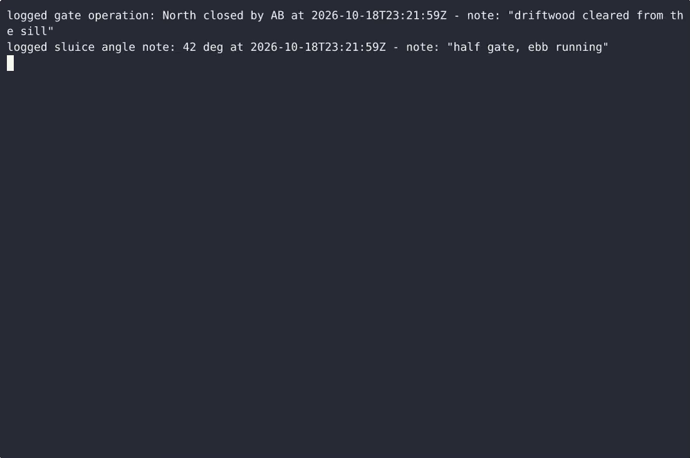
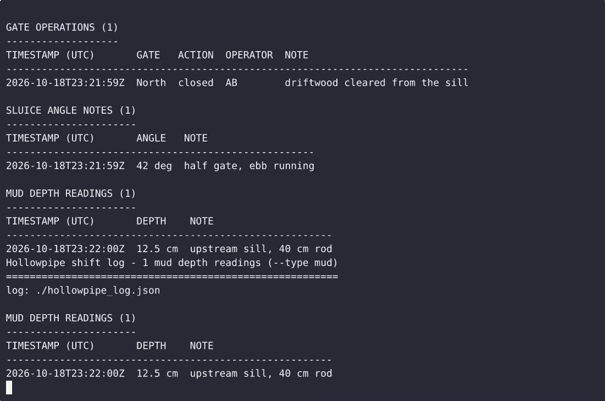

# Hollowpipe — complete Full-stack app command-line tool example app

This repository contains the complete source for **Hollowpipe**, an open-source command-line tool built with Full-stack app. Hollowpipe is a single-file, standard-library Python command-line tool for a tidal gate crew: it appends tide gate operation entries (gate, open/closed action, operator, note), sluice angle notes (whole degrees 0-90),…. Everything Hollowpipe needs to run is here — code, seed data, install scripts. Apache-2.0-licensed — use Hollowpipe commercially, self-host it, or [remix Hollowpipe on cenius.ai](https://cenius.ai/marketplace/p/hollowpipe?ref=gh&utm_campaign=hollowpipe-webapp) to make it yours.


[](LICENSE)  [](https://cenius.ai)

[](https://cenius.ai/marketplace/p/hollowpipe?ref=gh&utm_campaign=hollowpipe-webapp)

> **▶ [Open & edit in cenius.ai](https://cenius.ai/marketplace/p/hollowpipe?ref=gh&utm_campaign=hollowpipe-webapp)** — one click to an editable workspace: describe changes in plain English, get an instant preview, one-click deploy and host. Modifications made on the platform come with full rebrand & relicense rights.

_Local clone? See [Quick start](#quick-start) below. cenius.ai is the zero-setup path._

## Demo


📽 **[Demo video on cenius.ai](https://cenius.ai/marketplace/p/hollowpipe?ref=gh&utm_campaign=hollowpipe-webapp)** — the complete run-through · [MP4](.github/media/demo.mp4)

## Screenshots

 

## Architecture

Folder layout: `examples/`, `tests/`. Kick off `./install.sh` to pull packages and seed the database, then the app is up. Built in Full-stack app (25 files). Step-by-step setup guide: [`INSTALL.md`](INSTALL.md).

## Features

- Tide gate operation log
- Sluice angle notes
- Mud depth readings

## Quick start

```bash
./install.sh   # installs dependencies + seeds demo data
```

See [`INSTALL.md`](INSTALL.md) for full setup and usage instructions.

## Usage guide

Every command below runs from the directory that holds your shift log, because
the log always lives at `./hollowpipe_log.json`.

### 1. Log a tide gate operation

```bash
python3 hollowpipe.py gate add --gate North --action closed --operator AB \
                     --note "driftwood cleared from the sill"
```

```
logged gate operation: North closed by AB at 2025-07-12T05:40:12Z - note: "driftwood cleared from the sill"
```

`--gate` and `--action` are required. `--operator` and `--note` are optional; a
missing operator or note prints as `-` in the log. The timestamp is recorded
automatically as ISO 8601 UTC - you never type a time.

Rejected input prints exactly one line on stderr and changes nothing:

```bash
python3 hollowpipe.py gate add --action open
## error: gate name is required (try: hollowpipe.py gate add --gate North --action open)
## exit code 2

python3 hollowpipe.py gate add --gate North --action ajar
## error: action must be 'open' or 'closed' (got 'ajar'; try --action closed)
```

### 2. Record a sluice angle note

```bash
python3 hollowpipe.py sluice add --angle 42 --note "half gate, ebb running"
## logged sluice angle note: 42 deg at 2025-07-12T07:41:55Z - note: "half gate, ebb running"
```

Angles are whole degrees, 0-90 inclusive (`--angle 0` and `--angle 90` are both
valid). Anything else is refused:

```bash
python3 hollowpipe.py sluice add --angle 130
## error: angle must be a whole number between 0 and 90 (got 130)

python3 hollowpipe.py sluice add --angle abc
## error: angle must be a whole number between 0 and 90 (got 'abc')
```

_Full guide: [`USAGE.md`](USAGE.md)_

## FAQ

### How do I self-host Hollowpipe?

Grab the repo and run `./install.sh` — it handles packages and seed data in one go. After that, [`INSTALL.md`](INSTALL.md) walks you through starting the server. No external accounts required.

### What is Hollowpipe built with?

Powered by Full-stack app. This repo is the real thing — full source, seed data, and all — ready to clone and start up. Highlights include tide gate operation log.

### How do I make Hollowpipe my own brand?

Absolutely. [Open it on cenius.ai](https://cenius.ai/marketplace/p/hollowpipe?ref=gh&utm_campaign=hollowpipe-webapp) and remix it there — platform modifications come with full rebrand and relicense rights over your derivative, so the result is entirely yours.

### Is Hollowpipe free for commercial use?

The code is under the Apache-2.0 license, which allows commercial use without restriction. You can build, sell, and deploy it freely. Full text: [LICENSE](LICENSE).

### What if I want to add features to Hollowpipe without coding?

Yes — [load it on cenius.ai](https://cenius.ai/marketplace/p/hollowpipe?ref=gh&utm_campaign=hollowpipe-webapp), describe the change in plain English, and you get back a fresh build with your modification applied.

## License & rebranding

Released under the [Apache License 2.0](LICENSE) (© 2026 Cenius AI) — free for personal and commercial use. The Cenius name/logo are trademarks (see NOTICE).

**Need a customized version?** [Remix this app on cenius.ai](https://cenius.ai/marketplace/p/hollowpipe?ref=gh&utm_campaign=hollowpipe-webapp) — modifications made on the platform come with **full rebrand & relicense rights** over your derivative.

## Built with cenius.ai

This entire application — code, design, seeded demo data — was generated on **[cenius.ai](https://cenius.ai)** from a plain-English description.

- 🚀 [Build your own app on cenius.ai](https://cenius.ai)
- 🎛️ [Remix Hollowpipe on the marketplace](https://cenius.ai/marketplace/p/hollowpipe?ref=gh&utm_campaign=hollowpipe-webapp) — open it in a workspace, prompt for changes, and ship your own version.

More open-source apps: [the Cenius-ai catalog](https://github.com/Cenius-ai) · [showcase index](https://github.com/Cenius-ai/showcase)
